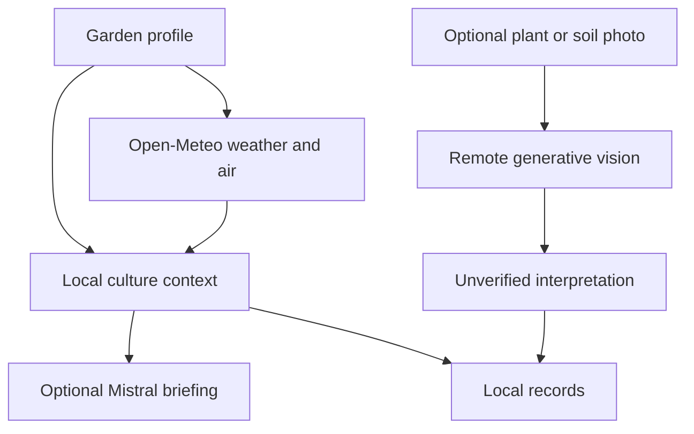

# Oracle du Jardinier — Studio Niko Design

**Garden management · Weather adapters · Optional vision-model assistance**

[Source](index.html) · [Licence](LICENSE.md) · [English overview](#english-overview)

## Architecture observée

| Composant dans index.html | Fonction constatée |
| --- | --- |
| `validateGardenRecords` | Validation de structure, coordonnées et identifiants |
| `fetchCurrentWeather` | Appels météo et air avec contrôle des réponses et états indisponibles |
| `moonPhase` | Cycle lunaire moyen approximatif, non éphéméride précise |
| `runDiagnosis` / `runSoilAnalysis` | Requêtes de vision générative Mistral |
| `prepareBackupStores` / `restoreBackupStores` | Préparation et restauration des données locales |
| [sw.js](sw.js) | Cache de la coque applicative |

Le profil pédologique est une catégorie renseignée, non une analyse physique du sol. Une photographie ne mesure pas le pH ou la composition chimique. Les réponses météo sont dépendantes des modèles du fournisseur ; la qualité de l'air n'est pas une mesure effectuée par le téléphone. Les interprétations génératives ne constituent pas une expertise phytosanitaire.

## Ce que fait l'application, en pratique

L'**Oracle du Jardinier** regroupe en une interface **météo, calendrier de culture, gestion des jardins, semences, tâches, rappels, journal de terrain et statistiques**. Il présente également des parcours de diagnostic photo, de comparaison et de conseils générés par IA lorsqu'un fournisseur est configuré.

**Statut :** assistant de jardin expérimental ; vérifier les informations botaniques, météorologiques et les dosages de produits avant application. Les repères biodynamiques restent interprétatifs.

**Studio Niko Design** — Assistant agronomique IA · Permaculture Loire-Atlantique 44 · v17

🔗 [oracle-du-jardinier.vercel.app](https://oracle-du-jardinier.vercel.app)

## ✨ Fonctionnalités
- Interprétation générative de photos de plantes et de sol (Mistral Vision · Ministral 3 / Mistral)
- Base 60+ plantes locales
- Données météo Open-Meteo, selon disponibilité
- Calendrier biodynamique

## 🛠 Stack
`HTML` · `Mistral AI` · `Ministral 3` · `Open-Meteo` · `IndexedDB` · `PWA`

## 👤 Auteur
**Nicolas Julienne** — Permaculteur · La Meilleraye-de-Bretagne (44)
📧 nicolasjulienne.nj@gmail.com

---

## Démarrage, usage et limites

**Thème :** Jardin, environnement & permaculture.

La page `index.html` se consulte sur un serveur web statique ; pour tester localement, utiliser `python3 -m http.server 8000`. L'application combine, selon sa documentation, des données météorologiques, des informations de jardinage et des services d'IA tiers.

**Qualité des conseils :** vérifier séparément les prévisions récentes, les espèces et les risques locaux. Les calendriers biodynamiques et les correspondances lunaires ne disposent pas du même niveau de preuve agronomique que des mesures de sol ou des prévisions météorologiques. Ne pas publier de clés API personnelles dans le dépôt.

**Statut :** projet de démonstration, sans validation fonctionnelle ou expertise indépendante revendiquée dans cette mise à jour.

[Voir le catalogue des projets](https://github.com/Nikoju1977).

## PWA — correction du 22 novembre 2026

L'ancienne inscription d'un Service Worker depuis une URL `blob:` a été remplacée dans le code par une inscription depuis `./sw.js` sur le même domaine. Le manifeste est désormais `manifest.webmanifest`, avec l'icône locale `icon.svg`. Le cache hors ligne ne concerne que la coque de l'application et le module facultatif Studio Niko Core ; **aucun résultat météo, conseil IA, compte ou donnée du jardin n'est stocké par le Service Worker**.

Cette correction est **committée**. Elle ne constitue pas un essai sur iPhone/Android, ni une garantie d'installation PWA selon les navigateurs. Le démarrage initial nécessite HTTPS et la disponibilité des fichiers. Les bibliothèques CDN et les services externes ne sont pas disponibles hors ligne.

## Qualification proposée

Avec jardins fictifs et réponses de fournisseurs simulées, vérifier les coordonnées, les états météo indisponibles, la protection des profils illisibles, la restauration et la séparation des jardins. Vérifier les flux de photos et de localisation, et la persistance de la clé dans le navigateur sans chiffrement applicatif établi. Ne pas saisir de secret ni de photo privée pour une démonstration. Les conseils de traitement doivent être confirmés par des sources agronomiques appropriées. Aucun nouveau test, appel API ou contrôle de déploiement effectué.

## English overview

Oracle du Jardinier combines garden records, weather and air-quality adapters, approximate lunar indicators, optional remote Mistral briefings and photo interpretation. Soil profiles and model-generated diagnoses are not laboratory measurements. Local records and credentials lack established application-level encryption. External services receive query data when used. No new functional, agronomic or deployment validation was performed.

[Notice de droits](LICENSE.md) : droits réservés pour les contributions originales concernées ; droits tiers préservés.
